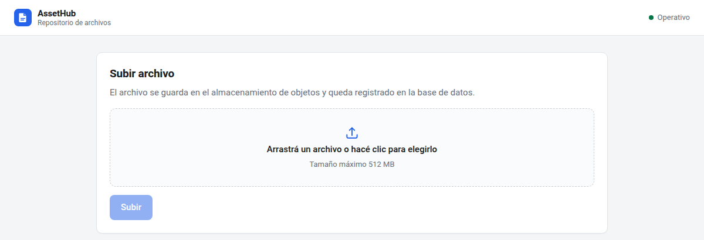
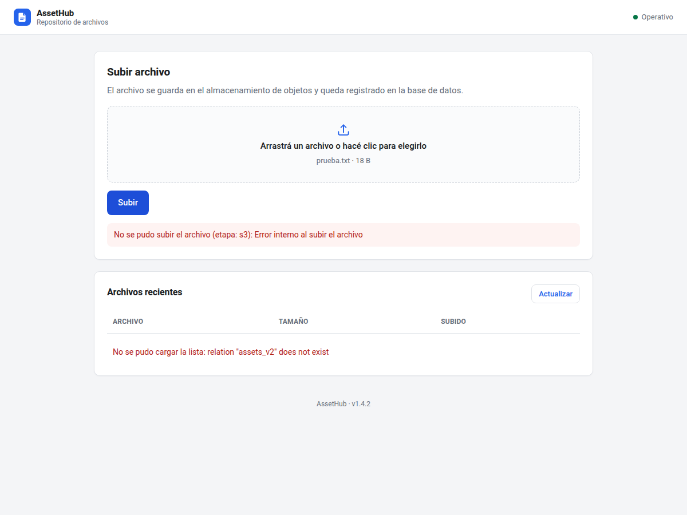
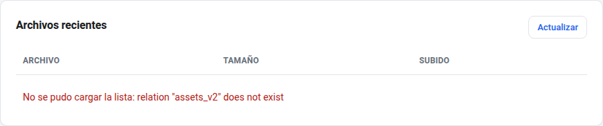
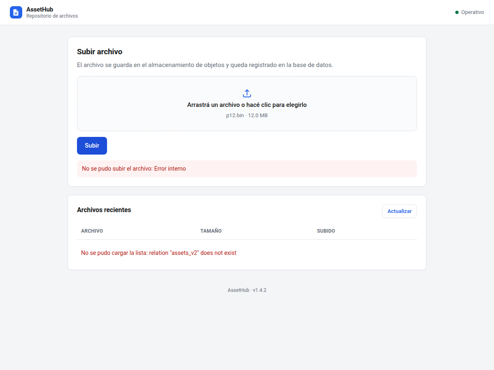

# Laboratorio: orquestación de servicios con Docker Compose

## Presentación

Vas a levantar AssetHub, una aplicación de tres servicios con Docker Compose. El
entorno arranca con tres fallas que aparecen en momentos distintos: una al subir
un archivo, otra al consultar los metadatos y otra después de varias subidas. Tu
trabajo es reproducir cada falla, encontrar la causa con las herramientas del
entorno y dejarla corregida.

Cada corrección necesita evidencia. No alcanza con decir qué cambiaste: tenés que
mostrar el comando que usaste, la salida que viste y la prueba de que el problema
desapareció.

## Objetivos

Al terminar el laboratorio deberías poder:

- leer el estado de un stack con `docker compose ps` y sus healthchecks;
- seguir el rastro de un error desde la respuesta HTTP hasta los logs del
  servicio que lo produjo;
- inspeccionar un contenedor en ejecución y su configuración efectiva;
- consultar el estado real de una base de datos desde su contenedor;
- distinguir un problema de red, uno de esquema y uno de espacio en disco;
- explicar qué cambia entre reiniciar un contenedor y recrearlo.

## Antes de empezar

- Tenés Docker Engine con Compose v2, `curl` y un navegador para probar la
  interfaz.
- Necesitás alrededor de 1 GB libre para las imágenes y los archivos de prueba.
- Trabajá sobre una copia del laboratorio. No edites archivos antes de reproducir
  cada falla: primero se observa, después se corrige.
- Guardá las salidas completas, no solo la última línea. Una captura sin el
  comando visible no sirve como evidencia.
- Los puertos publicados escuchan solo en `127.0.0.1`. El resto de la red no
  llega al laboratorio.
- La interfaz muestra los errores en pantalla, pero la evidencia del informe debe
  incluir la salida de los comandos y los logs. Una captura del navegador sola no
  alcanza.

## Servicios

| Servicio | Imagen | Función | Acceso |
|---|---|---|---|
| `app` | build local con Node.js | interfaz web, API HTTP, subidas y metadatos | `http://localhost:3000` |
| `garage` | `dxflrs/garage:v2.5.0` | almacenamiento compatible con S3 | interno, API publicada en localhost |
| `postgres` | `postgres:15-alpine` | base de datos de metadatos | solo desde la red del stack |

La aplicación corre con el usuario `node`, sin privilegios y con el sistema de
archivos de solo lectura. Los únicos directorios escribibles son los `tmpfs`
declarados en el manifiesto.

## La aplicación

AssetHub tiene una interfaz web y una API. La interfaz usa los mismos endpoints
que vas a consultar con `curl`, así que un fallo del backend aparece en los dos
lados.

| Ruta | Método | Función |
|---|---|---|
| `/` | GET | interfaz web |
| `/health` | GET | estado de la base y configuración del almacenamiento |
| `/files` | GET | últimos 50 registros de metadatos |
| `/upload` | POST | subida `multipart/form-data` con el campo `file` |



*La interfaz de AssetHub al abrir `http://localhost:3000`.*

## Puesta en marcha

Ubicate en la carpeta del laboratorio y levantá el stack:

```bash
docker compose up -d --build
docker compose ps
```

Esperá a que los tres servicios figuren como `healthy` o `Up`. El primer arranque
puede tardar por la descarga de imágenes y la creación de la base.

```bash
curl -s http://localhost:3000/health
```

La respuesta muestra el estado de la conexión a la base y el endpoint S3 que la
aplicación tiene configurado. Guardala como punto de partida.

La interfaz está en `http://localhost:3000` y usa los mismos endpoints, así que
podés reproducir cada incidente desde el navegador o con `curl`.

Para seguir los logs mientras repetís una prueba:

```bash
docker compose logs -f app
```

## Incidente 1: la subida devuelve 500

### Síntoma

`POST /upload` responde `500 Internal Server Error` con cualquier archivo. La
respuesta incluye un campo `stage` que indica en qué etapa falló.

### Reproducción

```bash
printf 'archivo de prueba\n' > /tmp/prueba.txt
curl -i -F "file=@/tmp/prueba.txt" http://localhost:3000/upload
```

También podés subir el archivo desde la interfaz. El mensaje de error aparece
debajo del formulario, con la misma información que devuelve la API.



*El error de subida tal como se ve en el navegador.*

### Qué registrar

- código HTTP y cuerpo completo de la respuesta;
- las últimas 30 líneas de `docker compose logs app`;
- la configuración efectiva del contenedor, especialmente sus variables de
  entorno y sus puertos;
- el puerto en el que escucha el servicio de almacenamiento.

Comandos que pueden ayudar:

```bash
docker compose logs app --tail 30
docker inspect "$(docker compose ps -q app)" --format '{{range .Config.Env}}{{println .}}{{end}}'
docker port assethub-storage
docker compose exec garage /garage status
```

### Preguntas para la defensa

- ¿A qué host y puerto intenta conectarse la aplicación?
- ¿En qué puerto escucha realmente el servicio de almacenamiento?
- ¿Qué diferencia hay entre `docker compose restart app` y recrear el
  contenedor?
- ¿Por qué el healthcheck de la aplicación puede seguir en `healthy` mientras
  las subidas fallan?

### Criterio de aceptación

La misma subida responde `201` y el objeto queda guardado en el almacenamiento.
En el informe explicá qué variable o archivo cambiaste y cómo comprobaste que el
contenedor tomó el valor nuevo.

## Incidente 2: los metadatos no se guardan

### Síntoma

`GET /files` responde `500` con un mensaje de relación inexistente. Si el
Incidente 1 ya está corregido, `POST /upload` también falla, pero en la etapa de
base de datos.

### Reproducción

```bash
curl -i http://localhost:3000/files
```

Si abrís la interfaz, la tabla de archivos muestra el mismo error con el texto
`No se pudo cargar la lista`.



*El listado de archivos cuando la consulta a la base falla.*

Con el Incidente 1 resuelto:

```bash
curl -i -F "file=@/tmp/prueba.txt" http://localhost:3000/upload
```

### Qué registrar

- el mensaje y el código SQLSTATE que aparecen en la respuesta y en los logs;
- la lista de tablas que existen realmente en la base;
- las columnas de la tabla que sí existe;
- el nombre de la tabla que usa el código de la aplicación.

Comandos que pueden ayudar:

```bash
docker compose logs app --tail 30
docker compose exec postgres psql -U app -d assethub -c '\dt'
docker compose exec postgres psql -U app -d assethub -c '\d assets'
docker compose exec postgres psql -U app -d assethub -c "SELECT to_regclass('public.assets_v2');"
```

### Preguntas para la defensa

- ¿La tabla que busca el código existe en la base?
- ¿Cuál de las dos referencias representa el estado real de los datos?
- ¿Cómo corregirías la diferencia sin perder las filas existentes?
- ¿Qué debería pasar en el próximo despliegue para que el problema no vuelva?

### Criterio de aceptación

`GET /files` responde `200` y una subida nueva devuelve `201` con su registro en
la base. En el informe explicá qué cambiaste, por qué elegiste ese camino y qué
evita que el problema vuelva a aparecer en el próximo despliegue.

## Incidente 3: las subidas grandes llenan el disco

### Síntoma

Después de varias subidas, la aplicación responde `500` y en los logs aparece
`ENOSPC: no space left on device`. El contenedor sigue en ejecución y el
healthcheck puede seguir respondiendo bien.

### Reproducción

Generá un archivo de 12 MB y subilo varias veces:

```bash
dd if=/dev/zero of=/tmp/pesado.bin bs=1M count=12
for i in 1 2 3 4; do
  curl -s -o /dev/null -w "intento $i: HTTP %{http_code}\n" \
    -F "file=@/tmp/pesado.bin" http://localhost:3000/upload
done
```

La falla se puede ver incluso si los incidentes anteriores siguen abiertos: el
archivo temporal se escribe antes de llegar al almacenamiento o a la base. Desde
la interfaz podés repetir la subida del mismo archivo para ver el error en
pantalla, pero el diagnóstico real está en los logs y en el uso del disco.



*La subida falla también en la interfaz cuando el espacio temporal se agota.*

### Qué registrar

- uso del filesystem del contenedor antes y después de cada subida;
- tamaño y cantidad de archivos temporales;
- líneas de log con `ENOSPC`;
- estado del contenedor y cantidad de reinicios;
- diferencia entre `df` y `du` si el espacio no baja después de borrar.

Comandos que pueden ayudar:

```bash
docker compose exec app df -h /data/uploads
docker compose exec app ls -lh /data/uploads
docker compose exec app sh -c 'du -sh /data/uploads/* 2>/dev/null'
docker compose logs app --tail 20
docker inspect "$(docker compose ps -q app)" --format 'Running={{.State.Running}} OOMKilled={{.State.OOMKilled}} ExitCode={{.State.ExitCode}}'
docker compose exec app sh -c 'ls -l /proc/1/fd 2>/dev/null | grep deleted'
```

### Preguntas para la defensa

- ¿Quién escribe el temporal y quién debería borrarlo?
- ¿Qué pasa si la subida falla a mitad de camino?
- ¿Por qué `rm` puede no liberar espacio en algunos casos?
- ¿Qué relación hay entre el límite de tamaño de archivo y la capacidad del
  disco?
- ¿Por qué el healthcheck no detecta este problema?

### Criterio de aceptación

Con los incidentes anteriores resueltos, cinco subidas de 12 MB responden `201`,
el uso del disco se mantiene bajo y el directorio de temporales queda vacío
después de cada subida. En el informe mostrá la verificación y explicá qué
cambiaste y por qué eso evita que el problema se repita.

## Entregable

Un informe técnico en Markdown o PDF con esta estructura:

1. Portada con nombre, fecha y versión del laboratorio.
2. Para cada incidente: síntoma, evidencia (comando y salida), causa raíz, cambio
   aplicado y verificación posterior.
3. Una sección final con tres mejoras que aplicarías al manifiesto o al código
   para que el entorno se parezca más a uno real. Justificá cada una con lo que
   observaste.
4. Un párrafo sobre qué harías distinto la próxima vez en el orden de diagnóstico.

No incluyas secretos reales ni credenciales de otros entornos.

Tabla mínima de evidencias:

| Incidente | Evidencia indispensable | Verificación |
|---|---|---|
| 1 | respuesta HTTP y línea de log con el host y puerto | subida con `201` |
| 2 | `\dt`, `to_regclass` y la consulta del código | `/files` con `200` y fila nueva |
| 3 | `df`, `du`, log con `ENOSPC` | directorio vacío y disco bajo |

## Pistas

Estas pistas orientan el diagnóstico. No incluyen los pasos de corrección: la
solución y su justificación quedan a tu cargo.

- Los puertos que publica el manifiesto y los que usa la aplicación no viven en
  el mismo archivo.
- Un `restart` conserva las variables de entorno del contenedor. Una recreación
  vuelve a leer el archivo de configuración.
- La base puede tener tablas con un nombre distinto al que espera el código.
- `df` muestra el espacio del filesystem; `du` suma archivos visibles. Si no
  coinciden, puede haber archivos borrados con un descriptor abierto.
- El límite de tamaño de una subida no protege al disco por sí solo.
- Un healthcheck que solo consulta la base no detecta fallas de almacenamiento ni
  de disco.

## Evaluación

| Criterio | Puntos |
|---|---|
| Reproducción de cada incidente con evidencia clara | 30 |
| Diagnóstico correcto de la causa raíz | 30 |
| Corrección aplicada y verificada | 25 |
| Explicación oral o escrita y propuestas de mejora | 15 |

## Limpieza

Al terminar, apagá el stack y borrá sus volúmenes:

```bash
docker compose down -v
```

Eso elimina la base, los datos del almacenamiento y la red del laboratorio. Los
archivos del proyecto no se modifican. Si necesitás repetir la práctica desde el
estado inicial, pedile al docente que restaure los archivos de configuración y
código.
